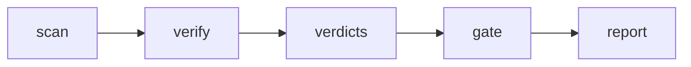

# Helix

Evidence-based quality checks and checkpoint workflows for repositories and AI coding agents.

`Python 3.11+` · `Node.js 20+` · `status: beta` · `0.9.3-beta`

[Polski](README.pl.md) · [Agent instructions](SKILL.md) · [Changelog](CHANGELOG.md)

`helix new` distinguishes provider approval (`data_egress`) from availability
probes. Source preparation records hashes, exclusions and heuristic redactions
as `NOT_SENT`. Missing approval returns `ERROR` before a model call or manual
export. Approved source reviews are also temporarily blocked until prepared
package transport is complete; neutral provider probes and offline planning
remain available. [Policy scope and format](docs/data-egress.md).

## Why Helix

- Finder ≠ verifier: deep security candidates go to a separate verifier.
- Three verdicts: `confirmed`, `needs_validation`, `rejected`; uncertainty stays visible.
- A coverage ledger records completed, skipped and uncovered work.
- Baseline/ratchet: new debt blocks according to policy; accepted old debt remains tracked with review dates.
- Evidence over declarations: reports include tool status, findings and gate results.



## Packs and workflows

| Pack / workflow | Checks | Tools | Blocks? |
|---|---|---|---|
| UX | Device/page matrix, accessibility, flows, keyboard, variants | Playwright, axe-core; optional model judge/explorer | With required UX gate; explorer advisory |
| Consistency | Runtime UI fingerprints, tokens, repeated components, design contract | Playwright, static Python analysis | Configured consistency gate |
| Security | Secrets, source rules, dependencies, local exposure heuristics | gitleaks, Semgrep, Trivy; optional osv-scanner/Bandit | Default high/critical ratchet |
| Security deep | Source review, independent validation, coverage ledger | Model CLIs, vendored Node validators | Opt-in `deep_required`; complete run required |
| Perf | Web vitals, transfer/bundle budgets, regressions, load thresholds | Lighthouse, optional k6 | Advisory by default |
| Integrity | Deleted tests/assertions, skips, snapshots, migrations, production deletions | Git, Python | Default high/critical ratchet |
| Code | Static UI/component consistency; behavior and code review gates | `consistency code`, configured test runner, model CLIs | Gates; no standalone code pack |
| Design brief/review | Reference images and design contract | Visual gate, consistency contract | Visual gate; dedicated brief/review pack planned |
| Task/board/tools/rules | Local task contracts, evidence, schema-checked tool calls, scoped rules | Python, Git, explicitly enabled local commands | Contracts block invalid actions; board is informational |
| Audit | Weekly session errors, accumulated costs and unanswered stops | Local session/run logs | Advisory; rule proposals need human acceptance |
| Review/UI deep | Static source review, AST and guard contracts | Python, ast-grep | Candidates for validation, no production proof |
| Runtime | Disposable app, database, identity, integrations and backup | Local service engine, PostgreSQL, Playwright | 0 complete PASS, 2 complete FAIL, 3 incomplete |
| New / Pro | Configuration proposal, preparation and imported evidence | Python; optional CLI probes | Contract handoff; unexecuted controls earn 0 points |
| Advisory tools | Unused code, duplicates, migrations, mutations, simplicity | Knip, jscpd, Squawk, mutmut/Stryker, Ponytail | Advisory, no quality points |

## Quickstart

Use a local Git checkout, Python 3.11+, Node.js 20+ and npm. Install only the scanners you intend to use. Model workflows require separately installed/authenticated provider CLIs; deterministic integrity checks need no model.

From the Helix checkout (installation needs network access):

```sh
python3 -m pip install -r requirements.txt
npm install --no-save playwright axe-core js-yaml@4
npx playwright install chromium webkit firefox
export PATH="$PWD/bin:$PATH"
helix --version
helix doctor
helix update --check
```

On Linux, Playwright may also need system browser libraries; follow its installer diagnostics. `helix doctor` reports dependencies and installation Git status and attempts a bounded origin fetch. `helix update --check` only reads local origin references. To fetch and fast-forward the Helix installation explicitly:

```sh
helix update
```

The updater refuses dirty or diverged installations; it does not reset, merge, stash or install dependencies.

First run against a repository with a Git commit (replace the paths):

```sh
helix --repo /path/to/example-app --offline new audit --out /tmp/example-app-preparation --no-probe
helix --repo /path/to/example-app --config /tmp/example-app-preparation/helix.proposed.json --state-dir /tmp/example-app-helix integrity scan --base HEAD
helix --repo /path/to/example-app --config /tmp/example-app-preparation/helix.proposed.json --state-dir /tmp/example-app-helix gate integrity --base HEAD
```

Review the proposal before scanning. It pins the running version; update an existing config pin deliberately. Use fresh output directories. HEAD checks current changes only; use a trusted base commit for a release comparison. External state keeps scan artifacts outside the target. `scan` collects findings; `gate` enforces policy. Pack gates return `0` PASS, `2` FAIL, `3` ERROR/INCOMPLETE. Missing scanners and changed binary files cannot produce PASS. Browser/model workflows may execute configured startup/test commands: use trusted repositories and inspect configuration first.

Illustrative report excerpt (not a real measurement):

```text
Bramka: FAIL; tryb: blocking
[high] ASSUMPTION Kasowanie kodu produkcyjnego — wymagany cytat
verdict: needs_validation
coverage: git-diff completed
```

Reports retain some Polish labels in this beta. Open the reported `report.md` path; structured findings, gate JSON and coverage ledger live alongside it. Local evidence/cache directories are ignored by Git.

## Configuration

Copy [helix.example.json](helix.example.json) to the target as `helix.json`, then adapt it. The example is a workflow template, not a promise that provider models or optional tools are available.

| Key | Meaning |
|---|---|
| `test_cmd`, `architecture_doc` | Behavior command and architecture context; null uses discovery |
| `mode` | `supervised` waits for approval; `autonomous` can commit after gates |
| `providers`, `models` | Role assignments, reviewers, model chains and fallback |
| `visual` | Startup command, local URL, reference, viewport and actions |
| `truth` | Require G0 and select its independent checker |
| `limits` | Attempt/round limits and checkpoint/provider timeouts |
| `packs.base_ref`, `packs.trusted_base` | Git reference and policy/baseline source for ratchet |
| `packs.security` | Scanners, rules, timeout, severity policy; optional `deep_required` |
| `packs.perf` | URL/pages, runs, budgets, optional explicit build and k6 commands |
| `packs.integrity` | Blocking severity policy and test file globs |
| `precheck.commands` | Optional argv lists; execution requires CLI `--trust-repo` |
| `worker.allow_hosts` | Exact worker host allowlist; omitted means no logged hosts allowed |
| `ux`, `consistency` | Optional browser matrix/flows and design contract; see SKILL.md and examples |

A precheck runs before review. Repository lint/type commands require explicit `--trust-repo` authorization and receive a small environment without inherited credential variables. This flag executes repository code; it is not a sandbox. Independently, enabled tools, behavior tests and startup commands also execute with user permissions. Inspect them before use.

A complete deep run is required when `deep_required` is enabled. Quick/scoped/partial runs cannot satisfy that gate; use the same external state directory for scan and gate. Baselines/waivers require owner review; accepting a secret additionally requires recorded rotation, revocation or false-positive justification.

## CI and AI agents

Example GitHub Actions step after installing Helix and dependencies (an example only):

```yaml
- name: Integrity gate
  env:
    HELIX_STATE: ${{ runner.temp }}/helix-state
  run: |
    helix --repo . --state-dir "$HELIX_STATE" gate integrity --base origin/main
```

Fetch the base reference before this step and upload external state as a restricted artifact after checking it for secrets. For security gates install the configured scanners and select trusted policy from a protected base. Run trusted repository commands only in an appropriately isolated job.

AI agents should read [SKILL.md](SKILL.md) and reference it from their repository's AGENTS.md. The workflow covers truth, planning, checkpoints, behavior, visual/review gates and human approval. Provider calls may send source/context to external model services. Keep credentials and confidential context out of inputs. No provider is required for the integrity quickstart.

## Limits and known gaps

- Worker host allowlisting is a log plus wrapper, not a firewall; hidden traffic and DNS rebinding are outside its guarantees.
- Browser viewports emulate devices. Safe area, Safari tint, fold hinges, native keyboards and real iOS behavior need physical-device review.
- Missing dependencies and incomplete coverage remain visible; an empty report is not evidence of safety.
- Scanner/model findings require validation. A deletion citation is context, not verified telemetry, and does not lower severity.
- Read-only external state applies to scan artifact placement; it does not sandbox configured code or model providers.
- SQL query counting and dedicated design brief/review are planned. Static heuristics and session accounting depend on the available inputs.
- Beta reports and CLI messages mix English and Polish. Cache is disabled for units involving symlinks.

## Feedback for testers

Test installation/doctor on your OS, missing dependencies, first scan/gate, baseline regressions, external state and resume, and browser flows on your own local app. Report issues in this private repository's Issues with OS, Python/Node/tool versions, exact command, expected vs actual behavior and reproduction steps. Attach `helix doctor` output and a sanitized report/coverage ledger. Remove tokens, source secrets, personal data and private URLs before sharing; do not upload raw logs blindly.

## Roadmap

Stabilize beta contracts and portability; improve device validation and localization; add SQL query evidence and design brief/review workflows; prepare a fresh public repository after owner review.

## License

MIT, see [LICENSE](LICENSE). Vendored third-party code keeps its own licenses; see [THIRD_PARTY_NOTICES.md](THIRD_PARTY_NOTICES.md).


## Helix New

`helix new` prepares greenfield and brownfield projects offline. Scale S/M/L/XL
and independent risk low/high/regulated select required artifacts. L/XL include
isolation, partitioning, residency/DR, numeric capacity, SLO, cost/tenant and
compliance plans. Source brand and the project running skill are mandatory.

```sh
helix new init --mode greenfield --profile S --risk low --dir ./app --out ../app-helix-new
helix new audit --repo ./existing --out ./audit-output
helix new brand check --dir ../app-helix-new/proposed
helix new check --dir ../app-helix-new/proposed
helix new handoff --dir ../app-helix-new/proposed
```

Init creates unapproved drafts, deliberately failing handoff until owners fill
and accept them. Audit treats repository content as data, never executes it and
writes only to disjoint output, including draft reconstruction in `proposed/`.
Brand gate compares approved source colors/fonts with DESIGN.md and the design
contract; it never invents a brand. Check validates schemas, required artifacts,
SHA-256 hashes, acceptance, claim labels and project skill content. Exit codes:
0 PASS, 2 FAIL, 3 ERROR. PASS establishes preparation completeness only.
JSON-formatted YAML templates need no extra dependency. See
[new/README.md](new/README.md) for contracts, acceptance and limitations.

S/M advanced features (cells, multi-region, sharding, microservices, Kafka) require an approved ADR with a positive numeric threshold.

Init now keeps the target unchanged and puts drafts in external `proposed/`.
Both init/audit produce `helix.proposed.json` and a short Polish `NEW-REPORT.md`:
version pin, preserved user choices, model availability/role plan, UI roots,
database/environment warnings, deep scan plan and full/daily/release schedule.
Only explicit `--write` creates new files in the target; existing files are never
overwritten. Use external `--config` and `--state-dir`; dated real model probes
come from `providers --refresh` or `--provider-cache`. Missing proofs are LIMITED,
not a successful login or independent review. `--offline --no-probe` executes no
models, application or local version commands. A missing egress policy remains
an owner question with an empty allowlist. See [proposal workflow](new/README.md).

Helix Pro standard (0.9.3-beta): `helix new audit --repo PATH --out EXTERNAL_DIR
--profile M` emits JSON/Markdown maturity scores and top three gaps for nine
separate quality areas. M+ handoff checks require PostgreSQL integration CI,
Playwright E2E and k6 SLO budgets; L/XL add reliability controls. Offline UX/UI
checks reuse Helix configuration and brand contracts, marked `needs runtime probe`.
Versioned requirements, dated exceptions and neutral CI templates:
[Helix New standard](new/README.md#helix-pro-standard-040-beta).

### Offline Pro maturity and improvement plans

`helix new audit --repo ./existing --profile M --out ./audit-output` reports weighted
scores across nine areas, top gaps and concrete template/Helix remediation steps.
Runtime controls stay `needs-runtime` and earn no verified points; configuration
gets a separate preparation score. Generate a reviewable checkpoint proposal with
`helix new plan --to pro --audit ./audit-output/audit.json --out ./improvement-plan.json`.
Design now includes 3–5 pattern references per key flow (M+ control), style presets
under approved brand intake and a task review before handoff. See
[Pro standard](docs/PRO-STANDARD.md); audit/plan run no target code; read-only Git metadata is retained. Only explicit provider refresh makes neutral availability calls.

### Field audit (0.3.1-beta)

`helix new audit --repo ./app --docs ../architecture.md --docs ../ops --out ../audit`
reads additional documents without modifying them. `helix.json` supports
`docs_paths: ["../architecture.md"]`, `profile: "M"`, and
`custom_gates: [{"name":"visual","area":"UI","command":"npm run gate:visual","file":"rules.ts","description":"Visual rules"}]`.
Areas use the exact names printed by the audit. Commands are recorded, never executed;
Unexecuted custom gates contribute only to preparation_score; execution earns zero
points and remains needs-runtime in the gap plan. See [project evidence](docs/project-evidence.md).
Invalid areas, missing files and declarations without a file or command are errors.
Playwright autodetection requires a projects array declaration. External selectors match
paths relative to each docs directory (or the parent of an individually supplied file);
.md, .txt, .yaml, .yml, .json and .sql documents are supported.
External documentation is cited with absolute path, line number and total lines.
Without a configured or explicit profile, scale signals infer S/M/L/XL with a loud
ASSUMPTION warning; `--strict-profile` refuses inference. `--profile` overrides config.
Default stdout is concise; `--verbose` includes full details, also saved under `--out`.
Both gap-plan.md and `helix new plan --to pro --audit ../audit/audit.json`
include every unresolved control, priority, remediation and acceptance evidence.

Monorepos discover workspace patterns and child manifests. Explicit configuration:
`"parts": [{"path":"frontend","status":"legacy"},{"path":"api","excluded":true}]`.
Legacy parts are scored; excluded parts are listed without scoring. Aggregate score
is the equal-weight mean of included parts; root_score retains the root assessment.
Part gaps also appear in the remediation plan.

For long gates, adapt [the sharded CI template](new/templates/ci/e2e.yml).
It runs four Playwright shards, retains blob artifacts per shard/attempt even on failure,
and merges HTML reports. Use Actions **Re-run failed jobs** to resume failed shards;
successful shard artifacts remain available in the same run. Keep the shard count,
project names and webServer consistent with your configuration. For pytest-split,
replace the command with `pytest --splits 4 --group <shard> --junitxml=report-<shard>.xml`
(after installing that optional plugin in your project), upload each XML and merge
with your existing JUnit report consumer. Missing shard artifacts mean incomplete evidence.

## Field-work contracts (0.9.3-beta)

Offline `helix contracts`, `helix merge-audit` and `helix owner-report --input helix-contracts.json` validate
owner acknowledgements, conflict resolutions, host test artifacts, rule changes,
budgets, ID reservations, domain links, configurable products, catalog modules,
version pins and documentation freshness. Start with
[the contract guide](docs/field-contracts.md) and
[neutral template](templates/helix-contracts.json). Unexecuted custom gates earn
zero maturity points; preparation is reported separately.

### Documentation and platform planning (0.9.3-beta)

VERIFIED (implementation: `bin/helix_pro.py`, `bin/helix_platform.py`): Pro now has
nine areas. `documentation` covers quickstart, architecture diagrams, ADRs,
OpenAPI, data/schema, on-call, contributing, releases, user/admin guides and
mtime freshness. Area weight 2; advisory score targets S/M/L/XL: 50/70/85/90.
Use `--docs PATH` or `docs_paths` in helix.json for explicit external documents.
Every Markdown document and OpenAPI/data-model/schema document needs an owner, ISO review date and explicit described-code
paths in `docs-metadata.json` (relative to that metadata file). Each document is
compared with its own code; stale pairs emit warnings. External documentation
uses the same metadata rules. This heuristic does not establish semantic accuracy. See [standard](docs/PRO-STANDARD.md).

```sh
helix new init --mode greenfield --profile XL --risk low --dir ./app --out ../preparation
helix new init --mode greenfield --profile M --risk low --platform --dir ./platform-app --out ../platform-preparation
helix new check --dir ./app --out ../preparation
```

Fill `platform-program.json`, approve artifacts and refresh manifest hashes.
XL/`--platform` requires nine products, owned capabilities/contexts, modular
monolith ADR with extraction criteria, versioned API/webhooks/apps, tenancy,
shared identity/design system, team/agent boundaries and per-product milestones.
Missing fields, orphan references, unowned milestones and dependency cycles fail.
Each dependency needs an approved contract referencing that milestone.

New project configs enable `design_decision.required`. Before `helix run cp1`,
copy `new/templates/design-decision.json.tpl` to `design-decisions/cp1.json`,
record at least two distinct approaches, benefits/trade-offs, selected variant,
owner approval and timezone-aware timestamp. The runner blocks before git or the
implementer if invalid. This checks an approval record, not the signer's identity.
Checkpoint reports and HANDOFF require `## What changed and why` with a concrete
explanation. Brownfield audit emits `system-map.json`: components with evidence
and unresolved static import hints, explicitly ASSUMPTION rather than live topology.

Project commands require `helix_version: "0.9.3-beta"` in `helix.json` before
execution. `new init` supplies the pin; update it deliberately and rerun both sides
of a comparison on that version. Approved design alternatives are required by
default even in existing projects. Helix New also requires `domain-map.json`:
nonempty mechanisms → patterns → components → industries, with valid many-to-many
links. Field contracts require explicit sections and populated core evidence;
a version pin alone cannot pass. UI conflict paths require before/after artifacts
even when the optional `ui` flag is omitted.

## Environment declarations and local versions

`helix env` compares repository declarations with locally observed tool versions.
It works offline, without starting the application, services or models. The report
keeps declarations, local observations and production evidence separate; a CI
matrix is a set of alternatives. PostgreSQL server and `psql` client binaries are
reported separately; installed binaries do not establish the version of a running
database server. Use `--no-probe` to skip local version commands.

```sh
helix --repo /code/app --offline env --no-probe --out /audits/app-environment
helix --repo /code/app --offline env --prod-evidence /audits/prod-versions.json --out /audits/app-environment-observed
```

`--out` must be outside the target and writes `environment.json` and
`environment.md`. Production stays unknown without `--prod-evidence FILE`:
each JSON `components` entry needs `version`, timezone-aware `checked_at` and
an `evidence` reference. Imported evidence is an explicit supplied observation,
not remote verification. The environment inventory reports variable names and
missing declarations only; values are not retained and real `.env` files are
skipped. `doctor --offline` also includes this environment summary.

Reports retain a shared `provenance` record: the Helix version and source Git
HEAD/dirty state, target HEAD/dirty state, Python interpreter and available
execution receipts for tools and models. Configured or available models are not
reported as models that answered; missing actual versions remain `unknown`.
Collecting metadata does not start probes or models. Owner reports separate
`generation_provenance` from imported `source_provenance`, so an old artifact
never inherits the current repository SHA or tool versions. A dirty flag requires
a retained source snapshot to reproduce the run.

## Disposable application runtime (0.9.3-beta)

Environment classification is advisory: SDK keys are dummy, service endpoints use loopback. Shared database sources, migration limitations and seed decisions are recorded; backup is independent of app health. Public routes and explicitly configured role/session GET checks have separate evidence.

`bin/helix runtime doctor --json` inventories local tools without starting services.
`bin/helix runtime plan --project PATH --json` detects frameworks, workspace apps,
package managers, routes, migrations and environment variable names offline.
`bin/helix runtime run --project PATH --out EXTERNAL_DIR --engine auto --budget-min 30`
uses a disposable copy, synthetic PostgreSQL and dummy secrets. Engines: podman,
docker, native PostgreSQL; `auto` falls back in that order. Explicit `service`
is for an ephemeral CI PostgreSQL service on localhost, never a production database.
Use `--part apps/web`, `--skip load,lighthouse`, or `--keep` for diagnosis.
The JSON schema is `schemas/runtime-report.json`; `runtime.md` and `logs/` retain
PASS/FAIL/BLOCKED/SKIPPED evidence. Runtime returns 0 for a complete PASS, 2 for a complete measured FAIL and 3 for incomplete coverage.
`helix new audit --repo PATH --out EXTERNAL_DIR --runtime-report REPORT` imports
measured load, CWV, accessibility, smoke E2E and restore results. Without a report,
the audit stays offline. Human UX reviews and policy controls remain separate.
`helix runtime ci-template --out runtime.yml` generates GitHub Actions YAML.
See [runtime details and safety](docs/runtime.md). No system installation or deployment
is performed by these commands. Runtime executes project code: use trusted synthetic
fixtures in an isolated worker with network restrictions; this is not an OS sandbox.


The [50-provider registry](data/integrations.json) and `runtime.integrations.custom`
select http-sink, record-replay, container or disable. Synthetic rows, callbacks
and responses come from project configuration. Package recognition covers npm,
PyPI, Go, Composer and Gem; interception covers Node fetch/http/https and Python
requests. Go/PHP/Ruby package discovery is not transport support. Unknown HTTP
records shapes without values and an inactive proposal; default 2xx stays blind.
Readiness, local capture and provider behavior are separate evidence.

Keycloak requires a local image and explicit role mapping. HTTPS, per-role
session/GET checks and WebAuthn have bound plans and execution receipts; a library
or cookie does not prove login. PDF/UTC checks are limited smoke tests. Backup
requires row counts and checksums after restore; legacy evidence without checksums
cannot pass. See [adapters](docs/runtime-adapters.md), [sessions and roles](docs/runtime-identity-policy.md)
and [WebAuthn](docs/runtime-webauthn.md).

### Statyczne soczewki UX/UI

`bin/helix ui deep <repo> [--out /tmp/ui-review] [--format markdown]` analizuje
Svelte, JSX/TSX, Vue i HTML/CSS bez uruchamiania projektu ani instalacji.
JSON i polski Markdown zawierają dowody, confidence, liczniki per komponent,
checklisty i adversarial pass. Wyniki zapisuj poza targetem. Zakres, ograniczenia
oraz pomiar precision/recall: [docs/ui-deep-precision.md](docs/ui-deep-precision.md).

Static nine-lens review (no project execution, providers or network):
`helix review deep /path/to/repo --out /tmp/review-output`.
Combines Security, developer, architecture, QA, PM, operations, documentation and
existing UX/UI lenses. JSON schema and Polish Markdown; offline audits remain
unknown without local advisory/redacted scanner metadata.
See [scope and limitations](docs/security-deep.md) and
[synthetic precision/recall](docs/security-deep-precision.md).

Static deep review: inline async `forEach`, delegated reads across request conventions,
and Markdown finding correlation (`open` / heuristic `likely-fixed` / `unknown`)
are described in [security deep](docs/security-deep.md). Custom guard names do not prove object scope.

Runtime compares disposable schema candidates, recognizes HTTP 5xx as application failures, and offers a synthetic HTTPS OIDC provider (`--no-oidc-stub` disables it). Backup verifies dump/restore fidelity independently of schema completeness. See [runtime documentation](docs/runtime.md).

## Migracja ze starego Helixa

`<checkout>` oznacza katalog nowego Helixa. Wszystkie dotychczasowe argumenty
pozostają zgodne; wystarczy zamienić prefiks katalogu skryptów.

| Stare polecenie | Nowe zgodne wejście | Skrót CLI |
|---|---|---|
| `node helix-old/scripts/ui-audit.mjs URL --out DIR --case ID --sweep 280-1600:40 --ready-selector SELECTOR --baseline BASE` | `node <checkout>/scripts/ui-audit.mjs URL --out DIR --case ID --sweep 280-1600:40 --ready-selector SELECTOR --baseline BASE` | `helix visual audit URL --out DIR --case ID --sweep 280-1600:40 --ready-selector SELECTOR --baseline BASE` |
| `node helix-old/scripts/visual-baseline.mjs --from AUDIT --out BASE --approved-by NAME --note NOTE` | `node <checkout>/scripts/visual-baseline.mjs --from AUDIT --out BASE --approved-by NAME --note NOTE` | `helix visual baseline --from AUDIT --out BASE --approved-by NAME --note NOTE` |
| `node helix-old/scripts/perf-audit.mjs ROOT --out DIR --budget BUDGET --baseline BASE` | `node <checkout>/scripts/perf-audit.mjs ROOT --out DIR --budget BUDGET --baseline BASE` | `helix perf weight ROOT --out DIR --budget BUDGET --baseline BASE` |
| `printf '%s' "$PROMPT" &#124; sh helix-old/scripts/gemini-review.sh DIR` | `printf '%s' "$PROMPT" &#124; sh <checkout>/scripts/gemini-review.sh DIR` | `printf '%s' "$PROMPT" &#124; helix review screenshots DIR` |

W tabeli `&#124;` oznacza znak potoku powłoki.
Audyt: 0 passed, 1 failed, 2 incomplete. Bez przeglądarki/builda wynik jest
incomplete, nigdy PASS. Bez wzorca `summary.visual=not_checked`, ręczna recenzja
pozostaje wymagana. Zachowane formaty: `audit.json`, `report.html`,
`shot-<theme>-<width>.png`, `perf-audit.json` i zatwierdzany manifest `baseline.json`.
Domyślnie 6 szerokości × 2 motywy; sweep bada DOM bez dodatkowych zrzutów.
Gotowość obejmuje selektor, fonty, obrazy, spokój DOM/sieci i dwa identyczne zrzuty.
Maski i tolerancje są częścią kontraktu wzorca; oba limity diffu muszą być spełnione.
Panele pionowe mają dodatkowe ujęcia; `data-helix-ignore` jest ujawniane w ostrzeżeniach.

Playwright: `PLAYWRIGHT_MODULE` (jawna błędna ścieżka kończy audyt), projekt,
resolver `bin/dependencies.cjs`, w tym `npm root -g` i `HELIX_PLAYWRIGHT`.
Nic nie jest instalowane. PNG ma wbudowany dekoder node:zlib (8-bit, bez interlace,
gray/RGB/palette/RGBA, CRC i limit 40 mln pikseli); opcjonalny pngjs nadal działa.
Wzorzec zapisuj wyłącznie po rzeczywistej zgodzie osobną komendą; istniejący katalog
nie jest nadpisywany. Zgodność środowiska i SHA-256 są sprawdzane przed nawigacją.

Waga stron: SvelteKit output, Vite manifest, Next pages build-manifest lub statyczny
dist z wejściami HTML. Nieobsługiwany format (w tym Next app-only) daje incomplete.
Domyślne budżety: JS trasy 150 KiB gzip, plik strony 40 KiB, tolerancja 0,5 KiB.
`--init-baseline` odmawia nadpisu; `--update-baseline` najpierw sprawdza regresję
i wyłącznie obniża wartości. Nowa trasa ponad budżetem blokuje; istniejący dług
nie blokuje do chwili wzrostu. `--ssr URL --routes /a,/b` wymaga pięciu odpowiedzi 2xx
na trasę i pokazuje medianę. Heurystyka świeżości mtime nie dowodzi pełnego provenance.
SvelteKit zachowuje import wygenerowanego manifestu: audytuj wyłącznie zaufany build.

Gemini wymaga istniejącego `agy`; model: `HELIX_REVIEW_MODEL`, domyślnie
`gemini-3.7-flash-high`. Linux: plan + sandbox, bez zgód na komendy; macOS dodatkowo
sandbox-exec blokujący zapis poza stanem agy i katalogami tymczasowymi.
To nie jest pełna izolacja odczytu/sieci na poziomie systemu Linux.
Pusta, odmówiona lub ucięta recenzja daje 1; wymagany końcowy znacznik kompletności
jest dodany w instrukcji dla recenzenta. Odpowiedź pozostaje danymi niezaufanymi.

`helix ui deep ROOT --visual-report DIR` i `helix review deep ROOT --visual-report DIR
--weight-report PERF_DIR` dołączają krótkie wyniki wykonanych audytów.
Bez dowodów pokazują needs-runtime; analiza statyczna nie uruchamia aplikacji.
Istniejący runtime po uruchomieniu aplikacji zbiera sweep/DOM na wykrytych trasach
i wagę po buildzie; skróty z odnośnikami trafiają przez `--runtime-report` do raportu
`helix new audit`. Runtime nie inicjalizuje bazy ani zgody recenzenta automatycznie.

Testy: `python3 -m unittest discover -s tests` oraz `node --test tests/node/*.test.mjs`.
Brak Playwright/Chromium lub zakaz procesów potomnych daje skip z powodem;
skip nie dowodzi działania przeglądarki. Wrapper uruchamia testy z rzeczywistym Chromium.

## Large repositories

Keep configuration outside the target with `--config /audits/helix.json`; pin
`helix_version` to the running version. `--state-dir /audits/app` stores model
availability, progress, cache and the last complete revision. `--offline` disables
model calls and remote data/rule fetching; an unexecuted check never earns PASS.
`doctor --offline` runs tool version probes and retains safe failure diagnostics.

```sh
helix --repo /code/app --config /audits/helix.json --state-dir /audits/app providers --refresh --jobs 3
helix --repo /code/app --config /audits/helix.json --state-dir /audits/app providers --plan
helix --repo /code/app --config /audits/helix.json --state-dir /audits/app --offline security deep --mode full --plan
# First full review overnight, after inspecting the plan:
helix --repo /code/app --config /audits/helix.json --state-dir /audits/app security deep --mode full --yes
helix --repo /code/app --config /audits/helix.json --state-dir /audits/app security deep --mode daily
helix --repo /code/app --config /audits/helix.json --state-dir /audits/app security deep --mode release
helix --repo /code/app --config /audits/helix.json --state-dir /audits/app security deep --since HEAD~1 --jobs 2 --budget time=10m,calls=50 --plan
```

`full` scans the complete plan with three hunters and no time cap; estimates
above one hour require `--yes`. `daily` scans changes since the last complete
commit without a time cap. `release` prioritizes the same delta by risk and
limits active time to 30 minutes. Explicit `--jobs`, `--since` and
`--budget time=10m,calls=50` override mode defaults. Without a complete base or
explicit `--since`, daily/release requests a full run instead of silently starting
one. Partial/interrupted runs and uncommitted source trees do not advance the
complete-commit marker.

`--plan` makes no model calls and reports batches, bytes, call bounds and a time
estimate from observed throughput; without observations the estimate is unknown.
One shared budget counts hunters, verifiers, failures and retries. Durable state
is written after each attempt/batch; `--resume DIR` resumes a compatible checkpoint.
Validated hunter results are cached by source/context hashes and prompt/model
version. Verification runs again. Reports distinguish not_checked, blocked,
inconclusive and complete work; neither cache nor a partial report proves safety.

`providers --refresh` makes a short JSON roundtrip for every configured model and
stores dated evidence. Login and provider catalogs are not proof. `--plan` explains
roles from saved evidence. Explicit roles/models are immutable; an unavailable
choice yields proposals without silent substitution. Verifiers and reviewers must
belong to a different family from their author: OpenAI (codex), Anthropic (claude
and claude-via-agy), Google (gemini/flash), xAI (grok-cli). A missing independent
family yields LIMITED, never a passing independent-review gate.
Preferences are policy, not benchmark claims: planner Claude, Codex, Gemini, Grok;
implementer/hunter Codex, Claude, Gemini, Grok; verifier Grok, Gemini, Claude, Codex;
review Gemini, Claude, Grok, Codex; visual judge Gemini, Codex, Claude, Grok.
Claude via-agy follows native Claude; gemini-flash is last except for visual judge,
where it precedes Grok. Models come from config. Security deep uses this same plan:
any available JSON provider may hunt; verification requires another model family.
Explicit `--hunter`/`--verifier` preserve exact models. Missing fresh evidence at
start/resume yields LIMITED and a refresh proposal. An agy alias cannot disguise
a Claude/Gemini model family, and an unnamed agy default proves no independence.
Models admitted at startup may continue after the probe TTL during long runs;
a valid answer refreshes only that model in local run state. Initial admission
proofs, the role plan and actual executions remain separate in metadata.

Use `new init|audit --refresh-providers --jobs 3` for an explicit online
preparation step, or `providers --refresh --jobs 3` separately. Probes run in
isolated neutral directories and send only a constant JSON ping. Every completed
attempt is saved in configuration order; model availability and actual code
review remain distinct. Offline plus refresh fails before any calls or writes.

`owner-report --evidence /audits/runs --out /audits/OWNER.md` aggregates existing
scans, gates, verification, coverage and cost without owner-input. Revisions and
runs remain separate; unknown cost is not zero. Use explicit
`--input helix-contracts.json` for the previous contract-validation mode.

## Local machine pressure

Deep, UX, runtime and the fast test runner adapt admission to memory pressure
and load. High reduces concurrency; critical pauses new work while active
units finish. Waiting consumes the time budget and the default 300-second
pause limit yields an explicit incomplete result. Configurable `resources`
thresholds, telemetry limits and recorded decisions are described in
[resource control](docs/resources.md).

Failed UX retries replace the current PASS with a partial report, preserving old
evidence separately. Report-only aggregation is explicitly historical and does
not claim new model/browser calls. Deep validation respects the remaining time
budget. Runtime exits 0 only for a complete PASS, 2 for a complete measured FAIL,
and 3 for incomplete coverage; release and repository-hygiene errors also reach
the shell.

Use `helix --repo /code/app --state-dir /audits/app/state --offline status
--reminder-only` for a model-free, network-free reminder with commits since the
last complete source review and the suggested daily/release command. Missing
or invalid evidence means unknown backlog and a full review suggestion, never
zero. `status --json` includes local changes and receipt details. Explicitly
install `helix hooks install --post-commit` with the same external state directory
for a read-only reminder; installation never replaces an existing hook or runs
a scan.

`new audit` also records Ponytail comments deterministically in `quality.json`
and the owner report, without models. Example:
`// ponytail: ceiling: 50 rows; upgrade: indexed cache`.
The ledger keeps each file:line, ceiling, upgrade path, source area and the age
of the last line change at HEAD. Unknown age stays unknown; read and parser
gaps remain visible. Missing fields get `no-ceiling` or `no-trigger`.

```sh
helix --repo /code/app --state-dir /audits/app/state --offline new audit --out /audits/app/debt --no-probe
helix --repo /code/app --state-dir /audits/app/state --offline status
```

Use the same external state directory. Status only reads the recorded result;
changed sources make it historical. It never scans, runs blame or calls models.
The ledger does not award quality points or execute the model simplicity lens.
[Contract](references/ponytail.md).

Manual `grok` reviewers receive separate requests bound to reviewer, checkpoint,
round and the complete diff. Each verdict needs a matching provenance receipt
with the request ID, SHA-256 of the verdict bytes and the declared exact model.
Use the paths and receipt template in `manual-request-*.md`. One answer cannot
cover two reviewers or a changed scope; missing responses remain pending.
Legacy shared response files remain historical evidence.

Metadata and deep planning share a Git reader that disables fsmonitor, avoids
configured filters and does not inherit another repository through GIT_DIR or
GIT_WORK_TREE. A known SHA is retained when filters or submodules prevent safe
worktree inspection; dirty remains null with an explanation. This cannot
advance a COMPLETE cursor. Incremental planning refuses an unsafe worktree diff
and points to full planning. Source inventory only reads filenames.

`helix --config /audits/app/helix.proposed.json --offline runtime plan
--project /code/app --json` lists integrations, strategies and source locations
without starting services. Runtime keeps individual measurements separate from
dependency coverage: readiness cannot verify a route, and coverage gaps or
missing legacy inventory return exit 3. A complete measured failure returns 2.
See the [runtime integration contract](docs/runtime-integrations.md).

Runtime planning includes a per-part Keycloak `identity_plan`: client, callbacks, PKCE and roles. READY means the blueprint is complete, not that login ran; missing or conflicting declarations are BLOCKED. Supply non-secret declarations through external `runtime.keycloak.parts`. [Contract](docs/runtime-integrations.md#plan-tożsamości-keycloak).

The Keycloak runtime adapter requires a local 26.8.1 image and an external `env_roles` map. Receipts record the actual image ID, version, readiness and owned cleanup; missing prerequisites do not trigger a stub fallback. Readiness leaves login and route coverage untested. [Execution contract](docs/runtime-integrations.md#wykonanie-lokalnego-keycloaka).


## Managed tools

`helix tools plan` lists all declared tools, runner implementations, executable
presence and separate managed installation evidence without running tools or
project code. `helix tools install --yes --tool ast-grep --tool knip --tool jscpd --tool squawk --tool mutmut`
installs pinned versions only in `~/.local/share/helix/tools`, outside the target
and global package environments. Offline installation refuses; planning remains
available. Missing tools and unexecuted adapters remain coverage gaps, while an
installer smoke test never counts as a project scan.
[Contract, pins and limitations](docs/tools-install.md).

`helix review deep ROOT --out EXTERNAL_DIR` uses managed ast-grep for
AUTH/IDOR/OTP/UPLOAD/MASS. Reports retain parser coverage, local row/guard
relations and explicit lower-confidence lexical fallback. Target code never
runs; recognizing a guard does not establish production security.
[AST scope and limitations](docs/security-ast.md).

## CI and project evidence

The [CI workflow](docs/ci.md) defines Ubuntu/macOS jobs, SHA-pinned actions,
Semgrep taint fixtures and zizmor offline/pedantic. The merge evidence does not
include a GitHub Actions run. Local fast check: `python3 scripts/check_fast.py`.
An operator may activate `.githooks` after reviewing existing hooks; this does
not replace the full suite or release check.

```sh
helix --repo /code/app bench --labels /audits/labels.json --previous /audits/previous/benchmark.json --out /audits/bench-new
helix new ids reserve --registry /audits/shared-ids.json --prefix RULE --type rule --owner agent-a --purpose 'Brand check'
helix new ids list --registry /audits/shared-ids.json
helix new ids check --registry /audits/shared-ids.json
helix new modules --input /code/app/ai-modules.json
```

Bench reads reviewed labels; it does not call models or run the target app.
All worktrees must share the same absolute ID registry. `pro-evidence.json`
maps project gates to Pro controls. Unexecuted tests/CI affect preparation only.
Execution receipts bind SHA, cited files and logs; they do not authenticate the
host. AI and manual modules need the same catalog and project gates. Missing
`ai-modules.json` is NOT_CONFIGURED. [Contract](docs/project-evidence.md).

`model-call-<id>.json` records actual attempt duration, tokens and USD cost when
CLI telemetry supplies them. Model-written JSON is not usage evidence; absent
values stay null, including in checkpoint and owner reports.

## Tool requirements and generality

| Use | Requirements |
|---|---|
| AST | Managed ast-grep 0.51.0; missing parser coverage stays explicit |
| Unused code / duplicates / SQL | Knip 6.43.0 (Node/npm), jscpd 5.4.2 and Squawk 2.70.0 (Python wheels) |
| Python mutations | mutmut 3.8.0; existing CPython 3.12/3.13/3.11/3.10, project tests/dependencies and working Linux `unshare --net` |
| JS mutations | Separately pinned Stryker runner in a disposable copy; not installed by Helix |
| CI security | zizmor 1.15.0, Semgrep 1.181.0 for Helix CI; installed separately |
| Browser / runtime | Playwright browsers and axe-core; local service images/engine and PostgreSQL as declared by the project |

Ponytail 4.9.0 is vendored MIT guidance, not a scanner executable. Its model
simplicity lens is advisory and follows the role plan and data-egress policy.
Example plan: `helix --repo /code/app tools simplicity --since HEAD~1 --out /audits/simplicity`.
Incremental tool example: `helix --repo /code/app tools scan squawk --since HEAD~1 --out /audits/sql`.
[Advisory scope](docs/advisory-tools.md) · [Licenses](THIRD_PARTY_NOTICES.md).

The [nine-repository check](docs/generality.md) completed seven audits and left
two 900-second timeouts; env returned five rc0 and four INCOMPLETE results.
It is a historical series, not a benchmark of one merged revision. .NET SDK/TFM
recognition does not run MSBuild or discover NuGet integrations. Project guards,
providers, synthetic data and routes belong in configuration; client names must
never create global exceptions. [Merge evidence and open debt](docs/stage2-completion.md).
