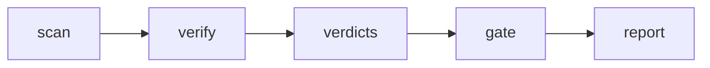

# Helix

Kontrole jakości oparte na dowodach i praca w checkpointach dla repozytoriów oraz agentów AI.

`Python 3.11+` · `Node.js 20+` · `status: beta` · `0.9.3-beta`

[English](README.md) · [Instrukcje agentów](SKILL.md) · [Historia zmian](CHANGELOG.md)

Propozycja `helix new` oddziela zgodę na dostawców (`data_egress`) od sond
dostępności. Przygotowanie źródeł zapisuje hashe, wykluczenia i heurystyczne
redakcje jako `NOT_SENT`. Brak zatwierdzonej polityki daje `ERROR` przed
modelem lub ręcznym eksportem. Przejściowo także zatwierdzony przegląd
źródeł jest wstrzymany do ukończenia transportu przygotowanych pakietów;
neutralne sondy providers i planowanie offline pozostają dostępne.
[Zakres i format polityki](docs/data-egress.md).

## Dlaczego Helix

- Finder ≠ verifier: kandydatów z deep security sprawdza osobny weryfikator.
- Trzy werdykty: `confirmed`, `needs_validation`, `rejected`; niepewność pozostaje jawna.
- Coverage ledger zapisuje wykonane, pominięte i niepokryte jednostki pracy.
- Baseline/ratchet: nowy dług blokuje zgodnie z polityką; zaakceptowany stary dług pozostaje śledzony z terminem przeglądu.
- Dowody zamiast deklaracji: raport zawiera stan narzędzi, ustalenia i wyniki bramek.



## Paczki i procesy

| Paczka / proces | Co sprawdza | Narzędzia | Czy blokuje? |
|---|---|---|---|
| UX | Macierz urządzeń/stron, dostępność, flow, klawiatura, warianty | Playwright, axe-core; opcjonalny model judge/explorer | Wymagana bramka UX; explorer doradczy |
| Consistency | Fingerprinty UI, tokeny, powielone komponenty, kontrakt projektu | Playwright, analiza statyczna w Pythonie | Skonfigurowana bramka spójności |
| Security | Sekrety, reguły kodu, zależności, heurystyki ekspozycji | gitleaks, Semgrep, Trivy; opcjonalnie osv-scanner/Bandit | Domyślnie ratchet high/critical |
| Security deep | Przegląd źródeł, niezależna walidacja, coverage ledger | CLI modeli, vendored walidatory Node | Opcjonalne `deep_required`; wymaga kompletnego przebiegu |
| Perf | Web vitals, budżety transferu/bundla, regresje, progi obciążenia | Lighthouse, opcjonalnie k6 | Domyślnie doradcza |
| Integrity | Usunięte testy/asercje, skipy, snapshoty, migracje, kasowanie produkcji | Git, Python | Domyślnie ratchet high/critical |
| Code | Statyczna spójność UI/komponentów; testy i przegląd kodu | `consistency code`, runner testów, CLI modeli | Bramki; brak osobnej paczki code |
| Design brief/review | Referencje wizualne i kontrakt projektu | Bramka visual, kontrakt consistency | Bramka visual; osobna paczka brief/review planowana |
| Task/board/tools/rules | Lokalne kontrakty zadań, dowody, narzędzia ze schematem, reguły ścieżek | Python, Git, jawnie włączone komendy | Kontrakty blokują błędne akcje; tablica informacyjna |
| Audit | Tygodniowe błędy sesji, sumowane koszty, zatrzymania bez odpowiedzi | Lokalne logi sesji/przebiegów | Doradcza; propozycje reguł zatwierdza człowiek |
| Review/UI deep | Statyczny przegląd kodu, AST i kontrakty guardów | Python, ast-grep | Kandydaci do sprawdzenia, bez dowodu produkcji |
| Runtime | Kopia aplikacji, baza, tożsamość, integracje, backup | Lokalny silnik usług, PostgreSQL, Playwright | 0 pełny PASS, 2 pełny FAIL, 3 niepełny przebieg |
| New / Pro | Propozycja konfiguracji, przygotowanie i import dowodów | Python; opcjonalne sondy CLI | Handoff sprawdza kontrakt; niewykonane kontrole mają 0 punktów |
| Narzędzia advisory | Nieużywany kod, duplikaty, migracje, mutacje, prostota | Knip, jscpd, Squawk, mutmut/Stryker, Ponytail | Doradcze, bez punktów jakości |

## Szybki start

Potrzebujesz lokalnego checkoutu Git, Pythona 3.11+, Node.js 20+ i npm. Zainstaluj skanery, których używasz. Procesy modeli wymagają osobno zainstalowanych i uwierzytelnionych CLI dostawców. Deterministyczna kontrola integrity nie wymaga modelu.

W katalogu Helixa (instalacja wymaga sieci):

```sh
python3 -m pip install -r requirements.txt
npm install --no-save playwright axe-core js-yaml@4
npx playwright install chromium webkit firefox
export PATH="$PWD/bin:$PATH"
helix --version
helix doctor
helix update --check
```

Na Linuksie Playwright może potrzebować systemowych bibliotek przeglądarek; kieruj się diagnostyką instalatora. `helix doctor` pokazuje zależności i stan checkoutu oraz próbuje pobrać stan origin z limitem czasu. `helix update --check` czyta wyłącznie lokalne referencje origin. Jawna aktualizacja instalacji Helixa przez fetch i fast-forward:

```sh
helix update
```

Updater odmawia aktualizacji przy lokalnych zmianach lub rozbieżnej historii; nie wykonuje reset/merge/stash ani instalacji zależności.

Pierwszy przebieg na repozytorium z commitem Git (podmień ścieżki):

```sh
helix --repo /path/to/example-app --offline new audit --out /tmp/example-app-preparation --no-probe
helix --repo /path/to/example-app --config /tmp/example-app-preparation/helix.proposed.json --state-dir /tmp/example-app-helix integrity scan --base HEAD
helix --repo /path/to/example-app --config /tmp/example-app-preparation/helix.proposed.json --state-dir /tmp/example-app-helix gate integrity --base HEAD
```

Przeczytaj propozycję przed skanem. Zawiera pin bieżącej wersji; istniejąca konfiguracja wymaga świadomego uaktualnienia pina. Każdy katalog wyników musi być nowy. Baza HEAD pokazuje tylko bieżące zmiany; do kontroli wydania wskaż zaufany commit bazowy. Zewnętrzny stan przechowuje artefakty poza projektem. `scan` zbiera ustalenia; `gate` egzekwuje politykę. Kody bramek paczek: `0` PASS, `2` FAIL, `3` ERROR/INCOMPLETE. Brak skanerów i zmienione pliki binarne nie dają PASS. Procesy przeglądarkowe/modelowe mogą wykonywać skonfigurowane komendy startu/testów: używaj zaufanych repozytoriów i przeczytaj konfigurację.

Przykładowy fragment raportu (ilustracja, nie pomiar):

```text
Bramka: FAIL; tryb: blocking
[high] ASSUMPTION Kasowanie kodu produkcyjnego - wymagany cytat
verdict: needs_validation
coverage: git-diff completed
```

Otwórz wypisaną ścieżkę `report.md`; obok są ustalenia, wynik bramki JSON i coverage ledger. Lokalne katalogi dowodów/cache są ignorowane przez Git. Raporty bety częściowo używają polskich etykiet.

## Konfiguracja

Skopiuj [helix.example.json](helix.example.json) do targetu jako `helix.json` i dostosuj. To szablon procesu, nie gwarancja dostępności modeli ani narzędzi.

| Klucz | Znaczenie |
|---|---|
| `test_cmd`, `architecture_doc` | Komenda testów i kontekst architektury; null oznacza wykrywanie |
| `mode` | `supervised` czeka na akceptację; `autonomous` może commitować po bramkach |
| `providers`, `models` | Role, recenzenci, łańcuchy modeli i fallback |
| `visual` | Start, lokalny URL, referencja, viewport i akcje |
| `truth` | Wymaganie G0 i wybór niezależnego checkera |
| `limits` | Limity prób/rund i timeouty checkpointów/dostawców |
| `packs.base_ref`, `packs.trusted_base` | Referencja Git oraz źródło polityki/baseline ratchetu |
| `packs.security` | Skanery, reguły, timeout, wagi; opcjonalne `deep_required` |
| `packs.perf` | URL/strony, powtórzenia, budżety, opcjonalne jawne build i k6 |
| `packs.integrity` | Blokujące wagi i globy plików testów |
| `precheck.commands` | Opcjonalne tablice argv; wykonanie wymaga CLI `--trust-repo` |
| `worker.allow_hosts` | Dokładne hosty workera; brak klucza nie zezwala na żaden zalogowany host |
| `ux`, `consistency` | Opcjonalna macierz/flow i kontrakt projektu; zobacz SKILL.md i przykłady |

Precheck poprzedza review. Komendy lint/typów z repo wymagają jawnego `--trust-repo` i dostają ograniczone środowisko bez odziedziczonych zmiennych poświadczeń. Flaga zezwala na kod repo; nie tworzy sandboxa. Włączone narzędzia, testy behavior i komendy startu także działają z uprawnieniami użytkownika - sprawdź je przed użyciem.

`deep_required` wymaga kompletnego deep. Quick/scope/partial nie spełniają bramki; użyj tego samego katalogu stanu dla skanu i bramki. Baseline i waivery wymagają przeglądu właściciela; sekret wymaga dodatkowo zapisu rotacji, unieważnienia albo uzasadnienia false-positive.

## CI i agenci AI

Przykładowy krok GitHub Actions po instalacji Helixa i zależności (wyłącznie przykład):

```yaml
- name: Integrity gate
  env:
    HELIX_STATE: ${{ runner.temp }}/helix-state
  run: |
    helix --repo . --state-dir "$HELIX_STATE" gate integrity --base origin/main
```

Wcześniej pobierz referencję bazową. Zewnętrzny stan możesz zachować jako artefakt o ograniczonym dostępie po kontroli sekretów. Bramka security wymaga skonfigurowanych skanerów i zaufanej polityki z chronionej bazy. Komendy repo wykonuj w odpowiednio izolowanym jobie.

Agenci AI powinni przeczytać [SKILL.md](SKILL.md) i wskazać go w AGENTS.md swojego projektu. Proces obejmuje prawdę/kontekst, planowanie, checkpointy, testy, visual/review i akceptację człowieka. Wywołania modeli mogą wysyłać źródła/kontekst do zewnętrznych usług. Usuń poświadczenia i poufny kontekst z wejść. Szybki start integrity nie wymaga dostawcy AI.

## Ograniczenia i znane luki

- Allowlista hostów workera to log i wrapper, nie firewall; ukryty ruch i DNS rebinding są poza jej gwarancjami.
- Viewporty emulują urządzenia. Safe area, tint Safari, zawiasy, natywna klawiatura i prawdziwe iOS wymagają kontroli na urządzeniu.
- Braki zależności i pokrycia pozostają jawne; pusty raport nie dowodzi bezpieczeństwa.
- Ustalenia skanerów/modeli wymagają walidacji. Cytat przy kasowaniu jest kontekstem, nie zweryfikowaną telemetrią i nie obniża wagi.
- Zewnętrzny stan read-only dotyczy miejsca artefaktów skanu; nie izoluje skonfigurowanego kodu ani modeli.
- Licznik SQL i osobna paczka design brief/review są planowane. Heurystyki i rozliczanie sesji zależą od dostępnych danych.
- CLI/raporty mieszają angielski i polski. Cache jest wyłączony dla jednostek obejmujących symlinki.

## Feedback for testers

Sprawdź instalację/doctor na swoim systemie, brak zależności, pierwszy scan/gate, regresje baseline, zewnętrzny stan i resume oraz flow w przeglądarce na własnej lokalnej aplikacji. Zgłaszaj Issues w tym prywatnym repo: system, wersje Python/Node/narzędzi, dokładna komenda, oczekiwany i rzeczywisty wynik, kroki reprodukcji. Dołącz wynik `helix doctor` oraz oczyszczony raport/coverage ledger. Usuń tokeny, sekrety źródeł, dane osobowe i prywatne URL; nie przesyłaj surowych logów bez sprawdzenia.

## Roadmap

Stabilizacja kontraktów bety i przenośności; lepsza walidacja urządzeń i lokalizacja; dowody liczby zapytań SQL oraz design brief/review; nowe publiczne repo po przeglądzie właściciela.

## Licencja

MIT, zobacz [LICENSE](LICENSE). Dołączony kod innych autorów zachowuje swoje licencje; zobacz [THIRD_PARTY_NOTICES.md](THIRD_PARTY_NOTICES.md).


## Helix New

`helix new` przygotowuje projekty greenfield i brownfield offline. Profile skali
S/M/L/XL oraz niezależne ryzyko low/high/regulated określają wymagane artefakty.
L/XL obejmują izolację, partycjonowanie, rezydencję/DR, liczbowy plan pojemności,
SLO, koszt tenanta i macierz compliance. Marka źródłowa i projektowy skill
prowadzenia projektu są obowiązkowe.

```sh
helix new init --mode greenfield --profile XL --risk regulated --dir ./app --out ../app-helix-new
helix new audit --repo ./existing --out ./audit-output
helix new brand check --dir ../app-helix-new/proposed
helix new check --dir ../app-helix-new/proposed
helix new handoff --dir ../app-helix-new/proposed
```

Init tworzy niezatwierdzone szkielety: handoff celowo FAIL do uzupełnienia i
akceptacji. Audyt nie wykonuje kodu repo; wyniki i szkielety rekonstrukcji
`proposed/` zapisuje poza repo docelowym. Bramka marki wymaga źródeł i zgodności
tokenów brand ↔ DESIGN.md ↔ kontrakt. Check sprawdza schematy, kompletność,
hashe SHA-256, akceptacje, VERIFIED/ASSUMPTION i treść skilla. S/M wymagają ADR
z progiem dla złożonej infrastruktury. Kody: 0 PASS, 2 FAIL, 3 ERROR. PASS oznacza
kompletność przygotowania, a nie gotowość produkcyjną. Szablony YAML zapisane
jako JSON nie wymagają nowych zależności. Kontrakty i ograniczenia:
[new/README.md](new/README.md).

Init domyślnie pozostawia cel bez zmian, a szkielety zapisuje w zewnętrznym
`proposed/`. Init i audit tworzą `helix.proposed.json` oraz krótki `NEW-REPORT.md`:
pin wersji, zachowane wybory użytkownika, dostępność modeli i role, ścieżki UI,
ostrzeżenia bazy/środowiska, plan deep i harmonogram full/daily/release.
Tylko jawne `--write` tworzy nowe pliki w celu; istniejących nie nadpisuje.
Używaj zewnętrznych `--config` i `--state-dir`; dowody modeli pochodzą z
`providers --refresh` lub `--provider-cache`. Brak dowodów daje LIMITED,
nie potwierdza loginu ani niezależnej recenzji. `--offline --no-probe` nie wywołuje
modeli, aplikacji ani lokalnych poleceń wersji. Brak polityki wysyłki pozostaje
pytaniem do właściciela z pustą allowlistą. [Przykłady przygotowania](new/README.md).

Helix Pro standard (0.9.3-beta): `helix new audit --repo PATH --out EXTERNAL_DIR
--profile M` zapisuje JSON/Markdown z wynikiem 0-100 i trzema głównymi lukami
osobno dla dziewięciu obszarów. Od M check wymaga CI PostgreSQL z migracjami i integracją,
E2E Playwright oraz k6 z budżetami SLO. L/XL dodają HA, odtwarzanie backupu,
observability, współdzielony rate limit i blokady rozproszone. UX/UI offline
ocenia konfigurację Helixa i kontrakty marki, oznaczając `needs runtime probe`.
Wymagania, wyjątki z terminem i neutralne szablony CI:
[Helix New](new/README.md#helix-pro-standard-040-beta).

### Dojrzałość Pro i plan poprawy offline

`helix new audit --repo ./existing --profile M --out ./audit-output` podaje ważone
wyniki dziewięciu obszarów, najważniejsze luki i kroki naprawy z szablonem i komendą Helixa.
Kontrole runtime mają `needs-runtime` i zero punktów za potwierdzenie; konfiguracja
ma osobny `preparation_score`. Plan checkpointów do przeglądu tworzy
`helix new plan --to pro --audit ./audit-output/audit.json --out ./improvement-plan.json`.
Design obejmuje 3-5 referencji wzorców na kluczowy flow (kontrola M+), presety
podporządkowane zatwierdzonej marce i przegląd zadania przed handoffem.
Szczegóły: [Pro standard (EN)](docs/PRO-STANDARD.md). Audyt i plan odczytują
metadane Git, bez wykonywania kodu projektu. Tylko jawne odświeżenie providerów
uruchamia neutralne sondy modeli; nie zastępuje G0.

### Audyt terenowy (0.3.1-beta)

`helix new audit --repo ./app --docs ../architektura.md --docs ../ops --out ../audyt`
czyta dokumenty bez ich modyfikacji; raport zapisuje ścieżki, numery i liczbę linii.
W `helix.json`: `"docs_paths":["../architektura.md"]`, `"profile":"M"`,
`"custom_gates":[{"name":"wyglad","area":"UI","command":"npm run gate:visual","description":"Reguły wyglądu"}]`.
Opcjonalne `file` wskazuje plik dowodowy. Nazwy obszarów odpowiadają raportowi.
Własne bramki i wykryte reguły/macierze testów, konfiguracja Playwright, skrypty
`gate:*`/`check:*` i cele Makefile zwiększają tylko preparation_score.
Bez wykonania mają zero punktów i pozostają needs-runtime w planie luk.
[Dowody projektu](docs/project-evidence.md) opisują import potwierdzeń wykonania.
Nieznany obszar, brak pliku lub brak file/command oznacza błąd. Playwright wymaga
deklaracji tablicy projects. Selektory dokumentów odnoszą się do katalogu --docs
lub rodzica pojedynczego pliku; obsługiwane są też rozszerzenia .yml i .sql.
Brak profilu wywołuje GŁOŚNE ostrzeżenie ASSUMPTION z sygnałami skali;
`--strict-profile` odmawia wnioskowania, `--profile` nadpisuje konfigurację.
Domyślne wyjście jest krótkie; `--verbose` pokazuje szczegóły zapisane też w `--out`.
Plan luk i `helix new plan --to pro --audit ../audyt/audit.json` zawierają wszystkie
nierozwiązane kontrole, priorytet, kroki naprawy oraz dowód odbioru.

Monorepo wykrywa workspaces i manifesty podkatalogów. Jawne części:
`"parts":[{"path":"frontend","status":"legacy"},{"path":"api","excluded":true}]`.
Legacy podlega ocenie, excluded nie. Agregat jest średnią uwzględnionych części;
`root_score` zachowuje ocenę korzenia. Plan uwzględnia również luki części.
Szablon [CI](new/templates/ci/e2e.yml) dzieli Playwright na cztery partie,
zapisuje artefakty każdej próby i scala raport HTML. W Actions wybierz **Re-run failed jobs**,
aby ponowić nieudane partie z zachowaniem artefaktów udanych. Dopasuj liczbę partii,
projekty i webServer. Dla pytest-split użyj `pytest --splits 4 --group <shard>
--junitxml=report-<shard>.xml`, archiwizuj każdy XML i scal w swoim odbiorcy JUnit.
Brak artefaktu partii oznacza niepełny dowód.

## Kontrakty pracy terenowej (0.9.3-beta)

Polecenia offline `helix contracts`, `helix merge-audit` i `helix owner-report --input helix-contracts.json`
sprawdzają decyzje i odbiór przez wykonawców, konflikty, dowody od gospodarza,
zmiany reguł, budżety, identyfikatory, mapę domeny, macierz konfiguracji, moduły
katalogowe, przypięcie wersji i aktualność dokumentacji.
[Kontrakt plików i polecenia](docs/field-contracts.md),
[neutralny szablon](templates/helix-contracts.json). Nieuruchomione bramki własne
mają zero punktów; przygotowanie jest oceniane osobno.

### Dokumentacja i planowanie platformy (0.9.3-beta)

VERIFIED (implementacja: `bin/helix_pro.py`, `bin/helix_platform.py`): dziewiąty
obszar Pro `documentation` obejmuje quickstart, architekturę z diagramami, ADR,
OpenAPI, model danych, on-call, onboarding, wydania, instrukcje użytkownika/admina
oraz świeżość mtime. Waga 2; doradcze progi S/M/L/XL: 50/70/85/90.
Dokumenty zewnętrzne wskazuje `--docs PATH` lub `docs_paths` w helix.json.
Każdy dokument Markdown oraz OpenAPI/model danych/schemat wymaga właściciela, daty przeglądu ISO i jawnych ścieżek
opisywanego kodu w `docs-metadata.json` (względem tego pliku metadanych).
Heurystyka porównuje każdy dokument z jego kodem i ostrzega o starszych parach.
Te same zasady obejmują dokumenty zewnętrzne; nie dowodzą zgodności treści. Szczegóły: [standard](docs/PRO-STANDARD.md).

```sh
helix new init --mode greenfield --profile XL --risk low --dir ./app --out ../przygotowanie
helix new init --mode greenfield --profile M --risk low --platform --dir ./platform-app --out ../platforma
helix new check --dir ./app --out ../przygotowanie
```

Wypełnij `platform-program.json`, uzyskaj akceptacje i odśwież hashe manifestu.
XL/`--platform` wymaga dziewięciu produktów, mapy capability/kontekst/właściciel,
ADR modular-monolith-first z kryteriami ekstrakcji, API/webhooków/aplikacji,
tenancy, wspólnej tożsamości i design systemu, granic zespołów/agentów oraz
roadmap per produkt. Brak pól, osierocone referencje, brak ownera lub cykl to FAIL.
Każda zależność milestone wymaga zaakceptowanego kontraktu ze wskazaniem milestone.

Nowe projekty włączają `design_decision.required`. Przed `helix run cp1` skopiuj
`new/templates/design-decision.json.tpl` do `design-decisions/cp1.json`; wpisz dwa
różne podejścia, korzyści/trade-offy, wybór, akceptującego i datę ze strefą.
Brak poprawnej decyzji blokuje runner przed git i implementerem. Walidator sprawdza
zapis akceptacji, nie tożsamość podpisującego. Raport checkpointu i HANDOFF wymagają
sekcji `## Co zmieniono i dlaczego` albo `## What changed and why` z wyjaśnieniem.
Audyt brownfield zapisuje `system-map.json`: komponenty z dowodami i statyczne
wskazówki importów jako ASSUMPTION, bez twierdzeń o topologii produkcji.

Polecenia projektu wymagają `helix_version: "0.9.3-beta"` w `helix.json` przed
wykonaniem. `new init` zapisuje pin; po świadomej zmianie wersji powtórz oba
pomiary porównania. Bramka zaakceptowanych wariantów projektu jest domyślnie
wymagana także w istniejących projektach. Helix New wymaga `domain-map.json`:
niepustych mechanizmów → wzorców → komponentów → branż i poprawnych powiązań
wiele do wielu. Kontrakty wymagają jawnych sekcji i niepustych dowodów podstawowych;
sam pin nie daje PASS. Ścieżki konfliktów UI wymagają zrzutów przed/po również
bez opcjonalnej flagi `ui`.

## Deklaracje środowiska i wersje lokalne

`helix env` porównuje deklaracje w repo z lokalnymi wersjami narzędzi. Działa
offline, bez uruchamiania aplikacji, usług i modeli. Raport oddziela deklaracje,
obserwacje lokalne i dowody produkcyjne; macierz CI oznacza alternatywne wersje.
Program serwera PostgreSQL i klient `psql` są wykazywane osobno; zainstalowany
program nie potwierdza wersji działającego serwera bazy.
`--no-probe` pomija lokalne polecenia sprawdzające wersje.

```sh
helix --repo /code/app --offline env --no-probe --out /audits/app-environment
helix --repo /code/app --offline env --prod-evidence /audits/prod-versions.json --out /audits/app-environment-observed
```

`--out` musi wskazywać katalog poza celem; zapisuje `environment.json` i
`environment.md`. Produkcja pozostaje nieznana bez `--prod-evidence FILE`:
każdy wpis JSON `components` wymaga `version`, daty `checked_at` ze strefą czasową
i wskazania dowodu `evidence`. Import jest jawną dostarczoną obserwacją, bez
zdalnej weryfikacji. Inwentarz zmiennych pokazuje nazwy i brakujące deklaracje;
wartości nie są zachowywane, a rzeczywiste pliki `.env` są pomijane.
`doctor --offline` również pokazuje podsumowanie środowiska.

Raporty zachowują wspólne `provenance`: wersję Helixa i HEAD/dirty jego kodu,
HEAD/dirty celu, wersję interpretera Python oraz dostępne dowody użycia narzędzi
i modeli. Model skonfigurowany lub dostępny nie jest modelem, który odpowiedział;
brak faktycznej wersji pozostaje `unknown`. Sam zapis metadanych nie uruchamia
sond ani modeli. Raport właściciela rozdziela `generation_provenance` od
importowanych `source_provenance`, więc stary artefakt nie dostaje aktualnego
SHA ani wersji narzędzi. Dla brudnego drzewa odtworzenie wymaga zachowanego
zrzutu źródeł.

## Efemeryczny runtime aplikacji (0.9.3-beta)

Klasyfikacja env jest podpowiedzią: klucze SDK są dummy, endpointy lokalne. Raport zapisuje wspólne źródła bazy, ograniczenia migracji i decyzje seed; backup działa niezależnie od aplikacji. Osobne dowody obejmują trasy publiczne oraz jawnie skonfigurowane kontrole sesji i GET dla ról.

`bin/helix runtime doctor --json` sprawdza narzędzia bez uruchamiania usług.
`bin/helix runtime plan --project PATH --json` wykrywa offline frameworki, części
monorepo, komendy, migracje, trasy oraz nazwy zmiennych środowiskowych.
`bin/helix runtime run --project PATH --out EXTERNAL_DIR --engine auto --budget-min 30`
pracuje na kopii, z efemerycznym PostgreSQL i sekretami dummy. Auto wybiera podman,
docker, następnie natywny PostgreSQL. `service` służy wyłącznie efemerycznej bazie CI
na localhost. Opcje: `--part apps/web`, `--skip load,lighthouse`, `--keep`.
Wyniki: `runtime-report.json`, `runtime.md`, `logs/`; status każdej kontrolki to
PASS/FAIL/BLOCKED/SKIPPED. Runtime zwraca 0 dla pełnego PASS, 2 dla pełnego zmierzonego FAIL i 3 dla niepełnego przebiegu.
`helix new audit --repo PATH --out EXTERNAL_DIR --runtime-report REPORT` importuje
pomiary obciążenia, CWV, a11y, smoke E2E i restore; bez raportu działa jak wcześniej.
`helix runtime ci-template --out runtime.yml` tworzy GitHub Actions YAML.
[Szczegóły i bezpieczeństwo](docs/runtime.md): tylko dane syntetyczne, żadne prawdziwe
`.env`, sekrety ani dane produkcyjne. Polecenia nie instalują nic systemowo i nie
wdrażają aplikacji. Kod projektu wymaga zaufanego, izolowanego workera z ograniczoną
siecią; kopia robocza sama nie jest sandboxem systemowym.


Rejestr [50 dostawców](data/integrations.json) i `runtime.integrations.custom`
obsługują strategie http-sink, record-replay, container i disable. Projekt
określa syntetyczne wiersze, callbacki i odpowiedzi. Rozpoznanie npm/PyPI/Go/
Composer/Gem nie oznacza transportu: przechwyt obejmuje Node fetch/http/https
oraz Python requests; Go/PHP/Ruby mają rozpoznanie pakietów. Nieznany HTTP
zapisuje kształt bez wartości i nieaktywną propozycję, a domyślne 2xx pozostaje
zaślepione. Readiness, lokalny przechwyt i działanie dostawcy są osobnymi dowodami.

Keycloak wymaga lokalnego obrazu i jawnego mapowania ról. HTTPS, sesje/GET
per rola i WebAuthn mają powiązane plany i receipts; deklaracja biblioteki lub
cookie nie zalicza logowania. PDF/UTC są ograniczonymi próbami. Backup wymaga
porównania liczności i checksum po restore; stary raport bez checksum nie zalicza
odtworzenia. [Adaptery](docs/runtime-adapters.md), [sesje i role](docs/runtime-identity-policy.md),
[WebAuthn](docs/runtime-webauthn.md).

## Ledger wymagań

`helix requirements check [--run] [--json]`, `requirements add` i
`requirements report`: [kontrakt i przykłady](docs/requirements-ledger.md).
Każda nowa wypowiedź właściciela → REQ z cytatem i źródłem w tym samym commicie.
Wrapper/CI: `helix requirements check --require-ledger-touch --since REF`
(zaufany ref sprzed zmian); wykrywa docs/owner-statements i trailer Owner-Statement.
Pending MUST są jawnym długiem; mapowanie testu nie oznacza jego wykonania.
Nie zatwierdzaj samodzielnie waiverów ani zmiany baseline.

## Ciągłość agentów

`helix agents generate`, `helix agents check`, `handoff write|read|check`, `claim take|release|list|check`,
`decisions add|list|check`, `continuity report [--json]` utrzymują stan w repo.
Polityka i pin: `.helix/agent-policy.json|yaml`; [instrukcja](docs/continuity.md).
Stary `handoff --run-id` nadal generuje raport przebiegu. Bez force push.

Statyczny przegląd dziewięciu soczewek, bez uruchamiania projektu ani sieci:
`helix review deep /path/to/repo --out /tmp/review-output`.
Raport JSON i Markdown po polsku łączy Security, developer, architect, QA, PM,
Ops/Data, Tech writer oraz istniejące UX/UI. [Zakres i ograniczenia](docs/security-deep.md),
[pomiar precision/recall](docs/security-deep-precision.md).

Runtime porównuje strategie schematu w osobnych bazach, rozpoznaje HTTP 5xx jako błąd aplikacji i udostępnia syntetyczny OIDC przez HTTPS (`--no-oidc-stub` wyłącza stub). Backup sprawdza wierność dump/restore niezależnie od kompletności schematu. Szczegóły: [runtime](docs/runtime.md).

## Opcjonalne adaptery OSS (0.9.3-beta)

`helix tools adapters` pokazuje rejestr; `helix tools scan shellcheck` analizuje
tymczasową kopię. Brak wykonania to 0 punktów i jawny powód.
Zakres wykonania i ograniczenia: [narzędzia](docs/tools.md).

Precyzja review 0.7.2: [werdykty, candidate i statystyki](docs/review-precision.md).

## Precyzja i czytelność 0.9.3-beta

Audyt zapisuje `coverage.json`, `quality.json` oraz paczkę modelu offline.
Pominięcia są jawne; nieuruchomione kontrole dają 0 punktów.
Zakres i ograniczenia: [precyzja i czytelność](docs/quality-stage2.md).

## Migracja ze starego Helixa

`<checkout>` oznacza katalog nowego Helixa. Wszystkie dotychczasowe argumenty
pozostają zgodne; wystarczy zamienić prefiks katalogu skryptów.

| Stare polecenie | Nowe zgodne wejście | Skrót CLI |
|---|---|---|
| `node helix-old/scripts/ui-audit.mjs URL --out DIR --case ID --sweep 280-1600:40 --ready-selector SELECTOR --baseline BASE` | `node <checkout>/scripts/ui-audit.mjs URL --out DIR --case ID --sweep 280-1600:40 --ready-selector SELECTOR --baseline BASE` | `helix visual audit URL --out DIR --case ID --sweep 280-1600:40 --ready-selector SELECTOR --baseline BASE` |
| `node helix-old/scripts/visual-baseline.mjs --from AUDIT --out BASE --approved-by NAME --note NOTE` | `node <checkout>/scripts/visual-baseline.mjs --from AUDIT --out BASE --approved-by NAME --note NOTE` | `helix visual baseline --from AUDIT --out BASE --approved-by NAME --note NOTE` |
| `node helix-old/scripts/perf-audit.mjs ROOT --out DIR --budget BUDGET --baseline BASE` | `node <checkout>/scripts/perf-audit.mjs ROOT --out DIR --budget BUDGET --baseline BASE` | `helix perf weight ROOT --out DIR --budget BUDGET --baseline BASE` |
| `printf '%s' "$PROMPT" &#124; sh helix-old/scripts/gemini-review.sh DIR` | `printf '%s' "$PROMPT" &#124; sh <checkout>/scripts/gemini-review.sh DIR` | `printf '%s' "$PROMPT" &#124; helix review screenshots DIR` |

W tabeli `&#124;` oznacza znak potoku powłoki.
Audyt: 0 passed, 1 failed, 2 incomplete. Bez przeglądarki/builda wynik jest
incomplete, nigdy PASS. Bez wzorca `summary.visual=not_checked`, ręczna recenzja
pozostaje wymagana. Zachowane formaty: `audit.json`, `report.html`,
`shot-<theme>-<width>.png`, `perf-audit.json` i zatwierdzany manifest `baseline.json`.
Domyślnie 6 szerokości × 2 motywy; sweep bada DOM bez dodatkowych zrzutów.
Gotowość obejmuje selektor, fonty, obrazy, spokój DOM/sieci i dwa identyczne zrzuty.
Maski i tolerancje są częścią kontraktu wzorca; oba limity diffu muszą być spełnione.
Panele pionowe mają dodatkowe ujęcia; `data-helix-ignore` jest ujawniane w ostrzeżeniach.

Playwright: `PLAYWRIGHT_MODULE` (jawna błędna ścieżka kończy audyt), projekt,
resolver `bin/dependencies.cjs`, w tym `npm root -g` i `HELIX_PLAYWRIGHT`.
Nic nie jest instalowane. PNG ma wbudowany dekoder node:zlib (8-bit, bez interlace,
gray/RGB/palette/RGBA, CRC i limit 40 mln pikseli); opcjonalny pngjs nadal działa.
Wzorzec zapisuj wyłącznie po rzeczywistej zgodzie osobną komendą; istniejący katalog
nie jest nadpisywany. Zgodność środowiska i SHA-256 są sprawdzane przed nawigacją.

Waga stron: SvelteKit output, Vite manifest, Next pages build-manifest lub statyczny
dist z wejściami HTML. Nieobsługiwany format (w tym Next app-only) daje incomplete.
Domyślne budżety: JS trasy 150 KiB gzip, plik strony 40 KiB, tolerancja 0,5 KiB.
`--init-baseline` odmawia nadpisu; `--update-baseline` najpierw sprawdza regresję
i wyłącznie obniża wartości. Nowa trasa ponad budżetem blokuje; istniejący dług
nie blokuje do chwili wzrostu. `--ssr URL --routes /a,/b` wymaga pięciu odpowiedzi 2xx
na trasę i pokazuje medianę. Heurystyka świeżości mtime nie dowodzi pełnego provenance.
SvelteKit zachowuje import wygenerowanego manifestu: audytuj wyłącznie zaufany build.

Gemini wymaga istniejącego `agy`; model: `HELIX_REVIEW_MODEL`, domyślnie
`gemini-3.7-flash-high`. Linux: plan + sandbox, bez zgód na komendy; macOS dodatkowo
sandbox-exec blokujący zapis poza stanem agy i katalogami tymczasowymi.
To nie jest pełna izolacja odczytu/sieci na poziomie systemu Linux.
Pusta, odmówiona lub ucięta recenzja daje 1; wymagany końcowy znacznik kompletności
jest dodany w instrukcji dla recenzenta. Odpowiedź pozostaje danymi niezaufanymi.

`helix ui deep ROOT --visual-report DIR` i `helix review deep ROOT --visual-report DIR
--weight-report PERF_DIR` dołączają krótkie wyniki wykonanych audytów.
Bez dowodów pokazują needs-runtime; analiza statyczna nie uruchamia aplikacji.
Istniejący runtime po uruchomieniu aplikacji zbiera sweep/DOM na wykrytych trasach
i wagę po buildzie; skróty z odnośnikami trafiają przez `--runtime-report` do raportu
`helix new audit`. Runtime nie inicjalizuje bazy ani zgody recenzenta automatycznie.

Testy: `python3 -m unittest discover -s tests` oraz `node --test tests/node/*.test.mjs`.
Brak Playwright/Chromium lub zakaz procesów potomnych daje skip z powodem;
skip nie dowodzi działania przeglądarki. Wrapper uruchamia testy z rzeczywistym Chromium.

## Higiena repo i wydania

`helix repo-hygiene [--require-exact]`, `helix release --dry-run --offline`
i `helix release check [--staged]`: [kontrakt i ograniczenia](docs/repo-hygiene.md).

## Duże repo

Konfigurację można przechowywać poza projektem: `--config /audits/helix.json`.
Pin `helix_version` musi odpowiadać uruchomionej wersji. `--state-dir /audits/app`
przechowuje dostępność modeli, postęp, cache i ostatnią kompletną rewizję.
`--offline` nie pobiera reguł ani danych, nie wywołuje modeli i nie uznaje
pominiętej kontroli za PASS. `doctor --offline` sprawdza rzeczywiste `--version`
narzędzi i podaje zredagowaną przyczynę awarii, np. `ca-certs: empty trust anchors`.

```sh
helix --repo /code/app --config /audits/helix.json --state-dir /audits/app providers --refresh --jobs 3
helix --repo /code/app --config /audits/helix.json --state-dir /audits/app providers --plan
helix --repo /code/app --config /audits/helix.json --state-dir /audits/app --offline security deep --mode full --plan
# Pierwszy pełny przebieg, np. na noc, po odczytaniu planu:
helix --repo /code/app --config /audits/helix.json --state-dir /audits/app security deep --mode full --yes
helix --repo /code/app --config /audits/helix.json --state-dir /audits/app security deep --mode daily
helix --repo /code/app --config /audits/helix.json --state-dir /audits/app security deep --mode release
helix --repo /code/app --config /audits/helix.json --state-dir /audits/app security deep --since HEAD~1 --jobs 2 --budget time=10m,calls=50 --plan
```

`full` czyta cały plan, domyślnie z trzema hunterami i bez limitu czasu;
szacunek ponad godzinę wymaga `--yes`. `daily` bierze różnicę od ostatniego
kompletnego commita, bez limitu czasu. `release` bierze tę różnicę w kolejności
ryzyka z domyślnym limitem 30 minut. Jawne `--since REF`, `--jobs N` i
`--budget time=10m,calls=50` nadpisują ustawienia trybu. Bez kompletnej bazy
i bez jawnego `--since` daily/release proponuje full zamiast uruchamiać go po cichu.
Znacznik kompletnej rewizji nie jest przesuwany po partial, przerwaniu ani dla
niezatwierdzonego drzewa, którego HEAD nie opisuje analizowanych źródeł.

Plan podaje partie, bajty, przedział liczby wywołań, priorytety i szacowany czas
na podstawie wcześniejszego tempa. Bez pomiaru czas jest nieznany. Budżet obejmuje
łącznie huntery, weryfikatorów, próby błędne i ponowienia. Zapis odbywa się po
każdej próbie i partii; `--resume /audits/run` wznawia zgodny checkpoint.
Cache dotyczy zwalidowanych odpowiedzi hunterów, treści i kontekstu źródeł oraz
wersji promptu/modelu. Weryfikator pracuje ponownie; cache nie dowodzi bezpieczeństwa.
Raport rozróżnia `not_checked`, `blocked`, `inconclusive` i ukończone jednostki.

`providers --refresh` wykonuje krótką odpowiedź JSON każdego skonfigurowanego
modelu, z datą i diagnostyką. Login ani katalog dostawcy nie są dowodem.
`providers --plan` czyta zapisane wyniki i wyjaśnia przydział ról.
Jawne role i modele pozostają niezmienione; brak dostępności daje propozycję,
bez cichego przełączenia. Rodziny to OpenAI (codex), Anthropic (claude,
claude-via-agy), Google (gemini, gemini-flash) i xAI (grok-cli).
Weryfikator i recenzenci muszą być z innej rodziny niż autor. Brak niezależnej
rodziny daje LIMITED i nie zalicza wymaganej bramki review.
Kolejność preferencji jest polityką Helixa, nie wynikiem benchmarku:
planista Claude → Codex → Gemini → Grok; implementer/hunter Codex → Claude →
Gemini → Grok; verifier Grok → Gemini → Claude → Codex; review Gemini → Claude →
Grok → Codex; visual judge Gemini → Codex → Claude → Grok. Warianty via-agy
są po natywnym Claude; gemini-flash jest na końcu z wyjątkiem visual judge,
gdzie poprzedza Groka. Nazwy modeli bierze konfiguracja.
Security deep korzysta z tego samego planu: każdy dostępny provider JSON może
być hunterem, a verifier musi należeć do innej rodziny. Jawne `--hunter`
i `--verifier` zachowują wybrany model; brak świeżego dowodu przed startem
lub wznowieniem daje LIMITED i propozycję `providers --refresh`.
Alias agy nie zmienia rodziny modelu Claude/Gemini. Model agy bez znanej nazwy
nie potwierdza niezależności. W długim przebiegu dopuszczony na starcie model
może dalej pracować, a poprawna odpowiedź odświeża tylko jego lokalny dowód.
Raport zapisuje plan, dowody początkowe i rzeczywiste wykonania osobno.

Jawne `new init|audit --refresh-providers --jobs 3` łączy przygotowanie
z krótkimi sondami modeli; osobno działa `providers --refresh --jobs 3`.
Sondy korzystają z neutralnych katalogów i wysyłają wyłącznie stały JSON ping.
Każda zakończona próba jest zapisywana w kolejności konfiguracji. Raport oddziela
te wywołania od recenzji źródeł. Offline połączone z refresh odmawia przed
wywołaniami i zapisem; istniejące wyniki nie są nadpisywane.

`owner-report --evidence /audits/runs --out /audits/OWNER.md` agreguje skany,
bramki, weryfikację, pokrycie i koszt bez ręcznego owner-input. Przebiegi i rewizje
pozostają osobne; nieznany koszt nie jest zerem. Tryb walidacji starego kontraktu
jest dostępny przez jawne `--input helix-contracts.json`.
Perspektywy per część, kalibracja i mapa danych: [opis etapu 3](docs/senior-pipeline.md).

## Raport właściciela i kontrole profilowe

`helix new audit` tworzy `owner-current.md` i pełny `owner-current.json`:
top problemy, decyzje, plan luk z ownerem/terminem, dryf i pokrycie czytania.
Wagi są pomocnicze; HIGH/critical i not-run blokują niezależnie od średniej.
`helix handoff run --run-id ID` jawnie wybiera raport przebiegu; dotychczasowa
składnia i `handoff write/read/check` pozostają dostępne.
`helix runtime mutation --project REPO --tool stryker --budget-seconds 60`
(lub mutmut) wymaga kopii tmp i izolacji sieci; brak warunków daje not-run.
Checklisty EU/PL, testów, obserwowalności, FinOps, danych i SEO oraz ograniczenia:
[opis etapu 4](docs/quality-stage4.md). Sygnały nie oznaczają certyfikacji.

## Obciążenie lokalnej maszyny

Deep, UX, runtime i szybka bramka testów ograniczają dopuszczanie nowych zadań
na podstawie pamięci i load. High obniża równoległość, critical wstrzymuje
nowe jednostki; aktywne kończą pracę. Pauza zużywa budżet, a po domyślnych
300 s daje jawny niepełny wynik. Progi `resources`, źródła pomiarów i decyzje
są opisane w [kontroli obciążenia](docs/resources.md).

Nieudane ponowienie UX zastępuje bieżący PASS raportem częściowym, zachowując
stare dowody osobno. Samo generowanie raportu ma zakres historyczny i nie
przypisuje sobie dawnych wywołań modeli ani przeglądarek. Walidator deep
respektuje pozostały budżet. Runtime kończy się 0 tylko przy pełnym PASS, 2 przy
pełnym wykonanym FAIL i 3 przy niepełnym pokryciu; release i repo-hygiene również
przekazują kod błędu do powłoki.

Przypomnienie o audycie działa bez modeli i sieci: `helix --repo /code/app
--state-dir /audits/app/state --offline status --reminder-only` pokazuje liczbę
commitów od ostatniego kompletnego przeglądu i polecenie `daily`/`release`.
Brak poprawnego dowodu oznacza nieznaną zaległość i zalecenie `full`, nigdy zero.
`status --json` udostępnia szczegóły; lokalne zmiany pozostają widoczne nawet
przy tym samym SHA. Tylko jawne `helix hooks install --post-commit` instaluje
odczytowy hook, bez zastępowania istniejącego pliku i bez uruchamiania skanu.
Przekaż ten sam zewnętrzny `--state-dir`, którego używasz do deep.

`new audit` zapisuje też deterministyczny rejestr komentarzy Ponytail
w `quality.json` i raporcie właściciela, bez modeli. Przykład:
`// ponytail: ceiling: 50 rows; upgrade: indexed cache`.
Rejestr pokazuje sufit, ścieżkę ulepszenia, plik:linia i wiek ostatniej zmiany
linii w HEAD. Nieznany wiek pozostaje nieznany, a luki odczytu są jawne.

```sh
helix --repo /code/app --state-dir /audits/app/state --offline new audit --out /audits/app/debt --no-probe
helix --repo /code/app --state-dir /audits/app/state --offline status
```

Status tylko odczytuje utrwalony wynik; zmienione źródła oznaczają wynik
historyczny. Brak sufitu lub ścieżki daje `no-ceiling`/`no-trigger`.
Komentarze w aktywnym kodzie, docs, legacy i testach pozostają rozdzielone.
To rejestr deklarowanego długu, bez punktów jakości i bez wykonania
modelowej soczewki prostoty. [Kontrakt](references/ponytail.md).

Ręczny reviewer `grok` dostaje osobny request związany z recenzentem,
checkpointem, rundą i pełną różnicą. Werdykt oraz receipt pochodzenia mają
własne nazwy: jedna odpowiedź nie może pokryć dwóch reviewerów ani nowego
zakresu. Użyj ścieżek i wzoru receipt z `manual-request-*.md`; receipt zawiera
SHA-256 bajtów werdyktu i konkretną deklarowaną nazwę modelu. Brak kompletu
pozostawia reviewer pending. Dawne wspólne pliki pozostają historią.

Metadane i plan deep używają wspólnego odczytu Git, który nie uruchamia
filtrów ani fsmonitor i nie dziedziczy `GIT_DIR`/`GIT_WORK_TREE` innego repo.
Przy filtrach lub podmodułach znany SHA pozostaje w raporcie, a stan zmian
ma `dirty=null` i wyjaśnienie. Taki wynik nie przesuwa kursora COMPLETE;
plan przyrostowy odmawia niebezpiecznej różnicy i wskazuje pełny plan.
Inwentarz źródeł zachowuje odczyt nazw bez wykonania kodu celu.

`helix --config /audits/app/helix.proposed.json --offline runtime plan
--project /code/app --json` pokazuje mapę integracji, strategie i miejsca
w kodzie bez uruchamiania usług. Raport runtime oddziela konkretne pomiary
od pokrycia zależności; readiness nie zalicza trasy, a jawne luki lub brak
starego inwentarza dają kod 3. Pełny wykonany FAIL daje 2. Szczegóły i kontrakt
dowodów: [integracje runtime](docs/runtime-integrations.md).

Plan runtime zawiera `identity_plan` Keycloaka per część: klient, callbacki, PKCE i role. READY opisuje kompletność planu, nie wykonane logowanie; braki i konflikty mają BLOCKED. Niesekretne deklaracje można uzupełnić w zewnętrznym `runtime.keycloak.parts`. [Kontrakt](docs/runtime-integrations.md#plan-tożsamości-keycloak).

Runtime Keycloak wymaga lokalnego obrazu 26.8.1 i mapy `env_roles` w zewnętrznym configu. Raport zapisuje faktyczny image ID, wersję, gotowość i cleanup; brak adaptera/silnika/obrazu nie uruchamia stubu. Readiness pozostawia logowanie i pokrycie tras nieprzetestowane. [Wykonanie](docs/runtime-integrations.md#wykonanie-lokalnego-keycloaka).


## Narzędzia lokalne

`helix tools plan` pokazuje cały katalog: deklarację, runner, obecność programu
i osobny dowód instalacji. Nie uruchamia narzędzi ani kodu projektu.
`helix tools install --yes --tool ast-grep --tool knip --tool jscpd --tool squawk --tool mutmut`
instaluje przypięte wersje w `~/.local/share/helix/tools`, poza repo i bez
instalacji globalnej. Offline odmawia instalacji; plan nadal działa.
Brak programu i nieuruchomiony adapter pozostają widocznymi lukami pokrycia.
[Instrukcja i ograniczenia](docs/tools-install.md).

Przegląd `helix review deep ROOT --out EXTERNAL_DIR` korzysta z zarządzanego
ast-grep dla AUTH/IDOR/OTP/UPLOAD/MASS. Raport zachowuje zakres parsera,
lokalne relacje guarda i wiersza oraz jawny fallback o niższej pewności.
Nie wykonuje kodu celu; rozpoznany guard nie przyznaje punktów bezpieczeństwa.
[Zakres reguł AST](docs/security-ast.md).

Narzędzia advisory, różnica Git i soczewka Ponytail: [instrukcja](docs/advisory-tools.md).

## CI i dowody projektu

[Workflow CI](docs/ci.md) definiuje zadania Ubuntu/macOS, akcje przypięte do SHA,
przykłady Semgrep taint i zizmor offline/pedantic. Dowody scalenia nie obejmują
uruchomienia GitHub Actions. Szybka kontrola: `python3 scripts/check_fast.py`.
Operator może włączyć `.githooks` po sprawdzeniu istniejących hooków. Nie zastępuje
to pełnych testów ani kontroli wydania.

```sh
helix --repo /code/app bench --labels /audits/labels.json --previous /audits/previous/benchmark.json --out /audits/bench-new
helix new ids reserve --registry /audits/shared-ids.json --prefix RULE --type rule --owner agent-a --purpose 'Kontrola marki'
helix new ids list --registry /audits/shared-ids.json
helix new ids check --registry /audits/shared-ids.json
helix new modules --input /code/app/ai-modules.json
```

Bench czyta zrecenzowane etykiety, bez modeli i uruchamiania aplikacji.
Wszystkie worktree muszą używać tego samego absolutnego rejestru ID.
`pro-evidence.json` łączy własne bramki z wymaganiami Pro. Niewykonane testy/CI
dają tylko przygotowanie. Potwierdzenie wykonania wiąże SHA, cytowane pliki i log;
nie uwierzytelnia hosta. Moduły AI i ręczne przechodzą ten sam katalog i bramki.
Brak `ai-modules.json` oznacza NOT_CONFIGURED. [Kontrakt](docs/project-evidence.md).

`model-call-<id>.json` zapisuje czas próby, tokeny i koszt USD, jeśli CLI podało
te dane. JSON napisany przez model nie jest dowodem zużycia. Brak danych pozostaje
null także w raporcie checkpointu i właściciela.

## Wymagania narzędzi i ogólność

| Zastosowanie | Wymagania |
|---|---|
| AST | Zarządzany ast-grep 0.51.0; brak pokrycia parsera jest jawny |
| Nieużywany kod / duplikaty / SQL | Knip 6.43.0 (Node/npm), jscpd 5.4.2 i Squawk 2.70.0 (pakiety wheel Pythona) |
| Mutacje Pythona | mutmut 3.8.0; istniejący CPython 3.12/3.13/3.11/3.10, testy i zależności projektu, działające linuksowe `unshare --net` |
| Mutacje JS | Osobny przypięty runner Stryker w kopii; Helix go nie instaluje |
| Bezpieczeństwo CI | zizmor 1.15.0 i Semgrep 1.181.0 dla CI Helixa, instalowane osobno |
| Przeglądarka / runtime | Przeglądarki Playwright i axe-core; lokalne obrazy/silnik usług oraz PostgreSQL zgodnie z deklaracją projektu |

Ponytail 4.9.0 to dołączone reguły MIT, bez osobnego programu skanującego.
Modelowa ocena prostoty jest doradcza i korzysta z planu ról oraz polityki wysyłki.
Przykład planu: `helix --repo /code/app tools simplicity --since HEAD~1 --out /audits/simplicity`.
Przykład analizy różnicy: `helix --repo /code/app tools scan squawk --since HEAD~1 --out /audits/sql`.
[Zakres narzędzi](docs/advisory-tools.md) · [Licencje](THIRD_PARTY_NOTICES.md).

[Sprawdzian 9 repo](docs/generality.md) ukończył siedem audytów, dwa przerwano po
900 sekundach. Env: pięć rc0 i cztery INCOMPLETE. To historyczna seria pomiarów,
nie benchmark jednej scalonej rewizji. Rozpoznanie SDK/TFM .NET nie uruchamia
MSBuild ani nie wykrywa integracji NuGet. Guardy, dostawcy, dane syntetyczne i trasy
należą do konfiguracji projektu; nazwa klienta nie tworzy globalnego wyjątku.
[Dowody scalenia i otwarty dług](docs/stage2-completion.md).
